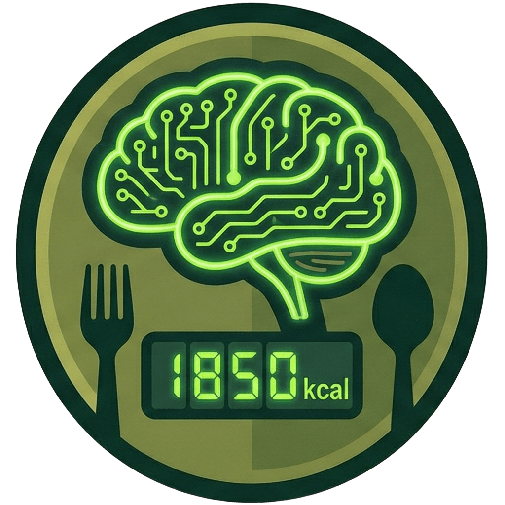
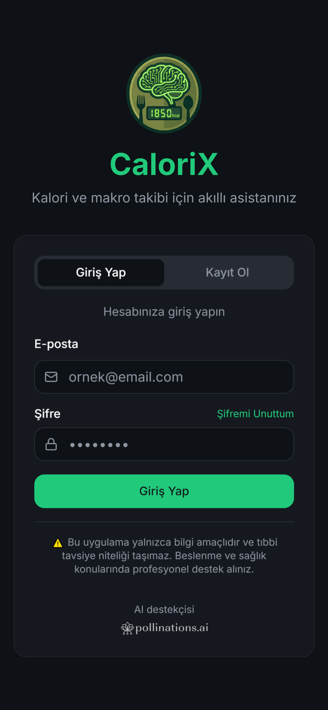
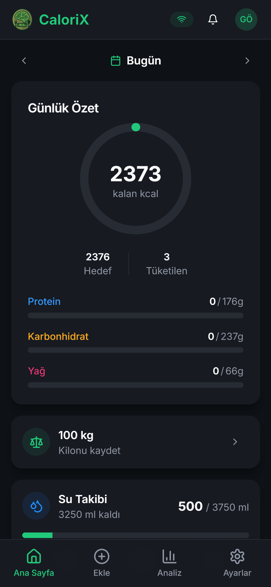
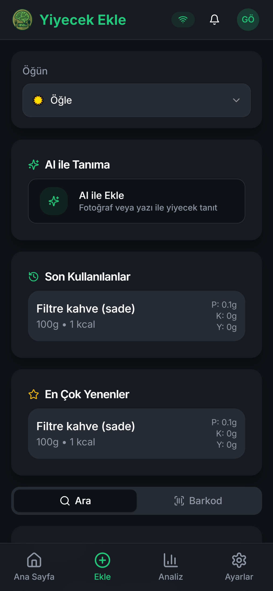
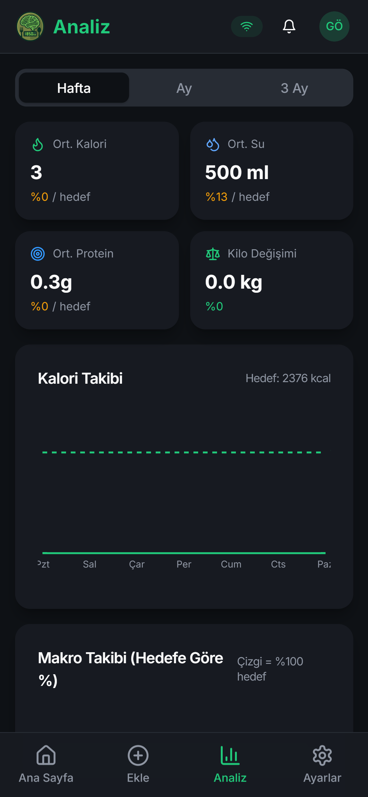

# 🔥 CaloriX

<div align="center">



**Akıllı Kalori, Makro Takip ve AI Beslenme Asistanı**

[](https://yediginibil.vercel.app)
[](https://github.com/GokhanOfficial/CaloriX)
[](CHANGELOG.md)
[](CHANGELOG.md)
[](LICENSE)

[🇺🇸 English](README_EN.md)

[🚀 Demo](https://yediginibil.vercel.app) • [📖 Özellikler](#-özellikler) • [📝 Değişiklikler](CHANGELOG.md) • [🛠️ Kurulum](#️-kurulum) • [📱 Ekran Görüntüleri](#-ekran-görüntüleri)

</div>

---

> ## 📱 Bu depoda iki istemci var
>
> | Yol | Durum |
> |-----|-------|
> | **`flutter_app/`** | **Ana uygulama** — Flutter (Android + web). Sürüm `pubspec.yaml`'da, geliştirme aktif. → [Kurulum ve mimari](flutter_app/README.md) |
> | `src/` | React PWA — **bakım modunda**, yeni özellik eklenmez. Vercel demosu bunu sunar. |
>
> İkisi aynı Supabase backend'ini ve aynı veri modelini kullanır. Aşağıdaki
> özellik/kurulum bölümleri React PWA içindir.

---

## 📖 Hakkında

CaloriX, günlük kalori, makro besin değerleri, su tüketimi ve kilo takibi yapmanızı sağlayan modern bir PWA (Progressive Web App) uygulamasıdır. AI destekli yemek tanıma ve AI Chat beslenme asistanı ile fotoğraf çekerek, metin yazarak veya sohbet ederek yediklerinizi kolayca takip edebilirsiniz.

> **Sürüm 1.1.0:** AI Chat beslenme asistanı eklendi. Hatalara ve veri tutarsızlıklarına neden olan offline sync altyapısı kaldırıldı.

## ✨ Özellikler

### 🍽️ Yemek Takibi
- **AI Destekli Tanıma**: Fotoğraf veya metin ile yemek tanıma
- **AI Chat Beslenme Asistanı**: Günlük kayıtlarınız, hedefleriniz ve beslenme kararlarınız hakkında sohbet ederek destek alın
- **Detaylı Besin Değerleri**: Kalori, protein, karbonhidrat, yağ ve daha fazlası
- **NOVA & Nutri-Score**: Gıda işlenme ve beslenme skorları

### 💧 Su Takibi
- Günlük su tüketimi hedefi
- Hızlı ekleme butonları
- Özel miktar girişi

### ⚖️ Kilo Takibi
- Düzenli tartılma hatırlatıcıları
- Kilo değişim grafikleri
- BMI hesaplama

### 📊 Analitik
- Haftalık, aylık ve 3 aylık trend grafikleri
- Makro dağılım analizleri
- Hedef başarı oranları

### 🔔 Bildirimler
- Push bildirim desteği
- E-posta hatırlatıcıları
- Özelleştirilebilir bildirim zamanları

### 🌙 Diğer
- Koyu/Açık tema desteği
- Türkçe arayüz
- PWA kurulum desteği
- Daha sade ve güvenilir veri akışı: Offline sync kaldırıldı

## 🛠️ Kurulum

### Gereksinimler

- Node.js 18+
- Bun veya npm
- Supabase hesabı

### Adımlar

1. **Repoyu klonlayın**
```bash
git clone https://github.com/GokhanOfficial/CaloriX.git
cd CaloriX
```

2. **Bağımlılıkları yükleyin**
```bash
bun install
# veya
npm install
```

3. **Ortam değişkenlerini ayarlayın**
```bash
cp .env.example .env
```

`.env` dosyasını aşağıdaki değişkenlerle yapılandırın:

| Değişken | Açıklama |
|----------|----------|
| `VITE_SUPABASE_URL` | Supabase Proje URL'i |
| `VITE_SUPABASE_PUBLISHABLE_KEY` | Supabase Anon Key |
| `VITE_SUPABASE_PROJECT_ID` | Supabase Proje ID'si |
| `OPENAI_API_KEY` | (Opsiyonel) AI yemek tanıma ve AI Chat için OpenAI uyumlu API anahtarı |
| `OPENAI_BASE_URL` | (Opsiyonel) OpenAI Proxy URL'i (varsayılan: https://gen.pollinations.ai/v1) |
| `OPENAI_MODEL` | (Opsiyonel) Kullanılacak AI modeli (varsayılan: openai) |
| `RESEND_API_KEY` | (Opsiyonel) E-posta bildirimleri için Resend API anahtarı |
| `VAPID_PUBLIC_KEY` | (Opsiyonel) Web Push bildirimleri için Public Key |
| `VAPID_PRIVATE_KEY` | (Opsiyonel) Web Push bildirimleri için Private Key |


4. **Geliştirme sunucusunu başlatın**
```bash
bun dev
# veya
npm run dev
```

5. **Tarayıcıda açın**
```
http://localhost:5173
```

## 🚀 Deployment

### Vercel ile Deploy

[](https://vercel.com/new/clone?repository-url=https://github.com/GokhanOfficial/CaloriX)

1. Vercel hesabınıza giriş yapın
2. "New Project" butonuna tıklayın
3. GitHub reposunu seçin
4. Ortam değişkenlerini ekleyin:
   - `VITE_SUPABASE_URL`
   - `VITE_SUPABASE_PUBLISHABLE_KEY`
5. "Deploy" butonuna tıklayın

### Manuel Build

```bash
bun run build
# veya
npm run build
```

Build çıktısı `dist/` klasöründe oluşturulur. Bu klasörü herhangi bir statik hosting servisine deploy edebilirsiniz.

## 🗄️ Veritabanı Kurulumu

CaloriX, backend olarak [Supabase](https://supabase.com) kullanmaktadır.

1. [Supabase](https://supabase.com) üzerinde yeni bir proje oluşturun
2. `supabase/migrations/` klasöründeki migration dosyalarını SQL editörde çalıştırın
3. Edge Functions'ları deploy edin:
```bash
supabase functions deploy
```

## 📝 Sürüm Notları

En güncel sürüm notları için [CHANGELOG.md](CHANGELOG.md) dosyasına bakın.

## 📦 Android Sürüm Yayınlama ve Zorunlu Güncelleme

Android APK'ları GitHub Releases üzerinden dağıtılır. Uygulama açılışında
[`releases/latest/download/latest.json`](https://github.com/GokhanOfficial/CaloriX/releases/latest/download/latest.json)
manifestini kontrol eder ve cihaz sürümüne göre davranır:

- **Zorunlu güncelleme**: Cihazın build numarası manifestteki
  `minSupportedVersionCode`'un altındaysa uygulama açılmaz; kullanıcı APK'yı
  tarayıcıdan kurana kadar "Güncelleme Gerekli" ekranı gösterilir.
- **Opsiyonel güncelleme**: Sürüme `minSupportedVersionCode` destekliyor ama
  yeniyse atlanabilir bir hatırlatma dialog'u çıkar.
- **Kontrol yapılamazsa** (çevrimdışı): Son başarılı manifest cihazda
  cache'lendiğinden karar yine verilir; hiç veri yoksa uygulama uyarıyla açılır.

Yayınlama akışı:

```bash
# 1) flutter_app/pubspec.yaml içinde sürümü yükselt: version: 1.3.0+4
#    (AppConstants.appVersion ve CHANGELOG.md'yi de eşitle —
#     node tool/check_versions.cjs kapıdır)

# 2) Normal sürüm (eskiler opsiyonel güncelleme görür):
tool/release_android.sh --notes-tr "Hata düzeltmeleri" --notes-en "Bug fixes"

# 3) DB migration'ı gibi kırıcı değişiklikte — build 3'ten eskiler ÇALIŞMAZ:
tool/release_android.sh --min-code 3
```

Script; release APK'yı derler, `sha256` + `latest.json` üretir ve GitHub
Releases'a yükler. `--min-code` mantığı: veritabanına migration girdiğinizde
(eski şemayla uyumsuzluk), o migration'ı içeren ilk build'in numarasını
`--min-code` olarak verin — altındaki tüm sürümler zorunlu güncellemeye düşer.

## 🔧 Teknolojiler

İki istemci aynı backend'i paylaşır; aşağıdaki tablo ikisini birlikte listeler.
**`flutter_app/` ana uygulamadır**, `src/` React PWA bakım modundadır.

| Kategori | Ana uygulama (`flutter_app/`) | React PWA (`src/`, bakım modu) |
|----------|-------------------------------|-------------------------------|
| Frontend | Flutter 3.47 / Dart 3.13 (Android + web) | React 18, TypeScript 5.8, Vite 5 |
| Styling | Material 3 + `app_theme.dart` | Tailwind CSS, shadcn/ui |
| State | Riverpod 2, `go_router` | TanStack Query, React Context |
| Yerel veri | Drift (SQLite) + `shared_preferences` | i18next-http-backend, localStorage |
| Backend | Supabase (PostgreSQL, Auth, Edge Functions) | aynı |
| AI | OpenAI GPT-5-Mini, [Pollinations.ai](https://pollinations.ai) | aynı |
| CI | `.github/workflows/flutter.yml` (analyze + test + build) | `.github/workflows/react.yml` (tsc + lint + build) |
| Deployment | GitHub Releases (APK), Flutter web build | Vercel |

## 🌸 AI Destekçileri

<div align="center">

[](https://pollinations.ai/)

**[Pollinations.ai](https://pollinations.ai/)**

CaloriX, AI görsel ve metin işleme yetenekleri için [Pollinations.ai](https://pollinations.ai/) tarafından desteklenmektedir. Pollinations, ücretsiz ve açık kaynaklı AI üretim platformudur.

</div>

## 📱 Ekran Görüntüleri

<div align="center">
  <div style="display: flex; justify-content: center; gap: 20px; flex-wrap: wrap;">
    <div style="text-align: center;">
        
        <p><strong>Giriş Ekranı</strong></p>
        <p>Kullanıcı girişi ve kayıt</p>
    </div>
    <div style="text-align: center;">
        
        <p><strong>Ana Sayfa</strong></p>
        <p>Günlük özet ve hızlı erişim</p>
    </div>
    <div style="text-align: center;">
        
        <p><strong>Yemek Ekleme</strong></p>
        <p>AI ile fotoğraftan tanıma</p>
    </div>
    <div style="text-align: center;">
        
        <p><strong>Analitik</strong></p>
        <p>Trend grafikleri</p>
    </div>
  </div>
</div>

## 🤝 Katkıda Bulunma

Katkılarınızı memnuniyetle karşılıyoruz! 

1. Projeyi fork edin
2. Feature branch oluşturun (`git checkout -b feature/amazing-feature`)
3. Değişikliklerinizi commit edin (`git commit -m 'feat: Add amazing feature'`)
4. Branch'i push edin (`git push origin feature/amazing-feature`)
5. Pull Request açın

## 📄 Lisans

Bu proje MIT lisansı altında lisanslanmıştır. Detaylar için [LICENSE](LICENSE) dosyasına bakın.

## 👨‍💻 Geliştirici

<div align="center">

**Gökhan Tekyıldırım**

[](mailto:gokhantekyildirim@outlook.com)
[](https://github.com/GokhanOfficial)

</div>

---

<div align="center">

Made with ❤️ in Turkey

**[⬆ Başa Dön](#-calorix)**

</div>
